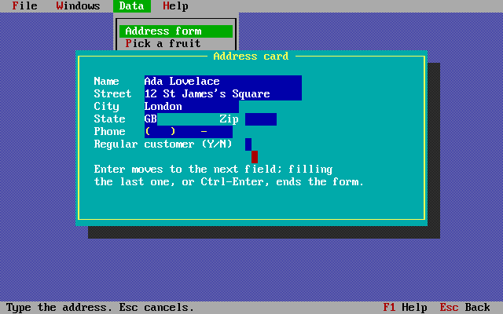

# CXL and TCXL compatible text library

CXL was Mike Smedley's shareware C library for DOS text-mode programs,
from 1987 to 1990: windows with borders and shadows, pull-down menus,
data entry forms, pick lists, context-sensitive help, keyboard, mouse,
printer and EMS support, and string utilities. TCXL 5.5 was its successor
under new names. Many programs from the time were written for it.

`libcxl.a` is a new implementation of that API, so such programs build
with clang-dos in every memory model. It is written from the published
manuals only, under the AGPL-3.0-only license; no CXL or TCXL code is in
it, and the internal record layouts, file formats and algorithms are its
own.



```sh
clang --target=i8086-pc-msdos -mcmodel=large -Os prog.c -lcxl -o prog.exe
```

## What is covered

The target is **CXL 5.2**, every documented function and global:

| Header | Contents |
| --- | --- |
| `<cxldef.h>` | `cxlver`, `biosver`, `machid`, the equipment-word functions, `clockcal`, `extmem`, `expmem`, `timer`, `delay_`, `sound_`, `beep`, `tabstop`, `sysdate`, `systime`, `randfile`, `fcrypt` |
| `<cxlvid.h>` | `_vinfo`, `videoinit`, adapter detection (including DESQview), direct video output, cursor, `ssave`/`srestore`, `box_`, screen and window files, CGA snow-free access |
| `<cxlkey.h>` | `getxch`, the key buffer (`kbput`, `kbputs`), `setonkey`, `kbstat`, `getns`, `inputsf`, `waitkeyt` |
| `<cxlmou.h>` | the `ms*` mouse functions and `mssupport` (mouse as arrow keys, as a pointer, or both) |
| `<cxlwin.h>` | windows, menus, forms, help, pick lists (`wpickstr`, `wpickfile`, `wselstr`, `wpickattr`) and window input and output |
| `<cxlstr.h>` | the `str*` functions and the `cvt*` field conversions |
| `<cxlprn.h>` | the `lprint*` printer functions, `scrndump`, `windump` |
| `<cxlems.h>` | the `ems*` LIM EMS functions |

`wpickstr` and `wselstr` take the `initelem` argument added in CXL 5.1.
Calls written for 5.0, without it, also compile: macros in `<cxlwin.h>`
count the arguments (define `CXL_NO_50_CALLS` to turn this off).

**TCXL 5.5** names come from `<tcxl.h>` (and the TCXL header names,
`<tcxlwin.h>`, `<tcxlmnu.h>`, ..., which include it). It maps the renamed
functions of the TCXL manual's Appendix H onto the CXL ones, and adds the
TCXL types (`IntT`, `ChrP`, `WndT`, ...), constants (`BOX_DBL`, `MNU_PUL`,
`FLD_UPR`, ...), the `Key_*` key codes of `<tcxlcod.h>`, and these
TCXL-only functions: `WpopUp`, `Wcenter`, `Werror`, `WputCen`, `Wputrj`,
`Wprtrj`, `Wprtns`, `Wprtsw`, `wprtf`, `WdupChrA`, `WdupStrA`,
`VcurHid`, `VcurSet`, `TcxlInit`, `TcxlTerm`, `EntFld` and `FldLoc`.
Functions that return a CXL `W_*` error return TCXL's `ERR_NUL`,
`ERR_ARG` or `ERR_MEM` instead, with the detail in `TcxlErr`.

Not provided from TCXL: its internal records (`WdfT`, `MdfT` and the
rest), the functions that take `VposT` positions, `MSpress`, `MSstat` and
`MSmove`.

## Building old programs

- Header names are lower case (`cxlwin.h`); DOS does not mind either way.
- clang spells `far` as `__far`. Code that says `far` builds with
  `-Dfar=__far` (likewise `-Dnear=__near`, `-Dhuge=__huge`).
- Old compilers defined `NULL` as `0`, and programs passed it for `int`
  arguments such as the menu help category. clang makes that an error;
  `-Wno-int-conversion` lets it through.
- Compiler library functions that are not part of CXL (Turbo C's
  `findfirst`, Microsoft's `<direct.h>`) are not supplied by `libcxl.a`;
  `<dirent.h>` has `opendir`/`readdir`.
- Large programs need the medium or large model, as with the compilers
  of the time.

The CXL 5.0 demonstration program builds and runs this way in the medium
and large models with only a stand-in for Turbo C's `findfirst`.

## Choices where the manuals are silent

The manuals describe behavior, not formats or algorithms. Where a program
could notice, the library does this:

- `wmenuget` returns the tag of the root menu item that was chosen, as the
  manual says; a choice in a pull-down menu ends `wmenuget` unless its
  item has a select function. A hot key on an item without a select
  function chooses it if it is in the current menu; the `M_EXITALL` tag
  works from anywhere.
- Filling the last character of the last form field ends `winpread`, as
  Enter there does. The form shows the cursor while it runs.
- `wpickstr` lays the strings out in as many columns as fit the window.
  `erow` or `ecol` of -1 sizes the window to the strings.
- `wselstr` changes the string in place: the arrow keys or Space step
  through the choices, Enter takes one.
- `wpickattr` returns -1 on Esc.
- `wsetfill`'s function is called as
  `fill(srow << 8 | scol, erow << 8 | ecol, ch, attr)`.
- `sound_`'s pitch is the timer divisor (1193180 / frequency).
- `strcode` XORs with the key and leaves a byte alone where the result
  would be NUL, so strings stay strings. `fcrypt` is a plain XOR, so
  running it twice restores a file. Neither matches the original CXL, so
  data encoded by a CXL program cannot be decoded.
- Screen and window files (`scrntodisk`, `wintodisk`) are four
  little-endian 16-bit words (start row, start column, end row, end
  column) followed by the character and attribute cells.
- Help files are plain text. A topic starts with a line `*B number,name`,
  `*P` starts a new page and `*E` ends the topic. `^Name^` is a
  cross-reference that Tab and Enter follow; it must be on the page shown.
  The default help window is 19 by 64, centered.
- `cvtic` and `cvtfc` fields hold no decimal point; `cvtcf` places it by
  `fracsize`.

## Example

[examples/dos/cxldemo.c](../examples/dos/cxldemo.c) is a tour: a menu bar
with pull-down menus and a status line, overlapping, moving and hidden
windows, an address form with validation, pick lists of strings and
files, the colour picker and help from
[cxldemo.hlp](../examples/dos/cxldemo.hlp) on F1.
[tests/dos/README.md](../tests/dos/README.md) shows how to run it in
DOSBox, and [tests/dos/cxl.c](../tests/dos/cxl.c) is the self-test that
`run-tests.sh` runs in emu2.
